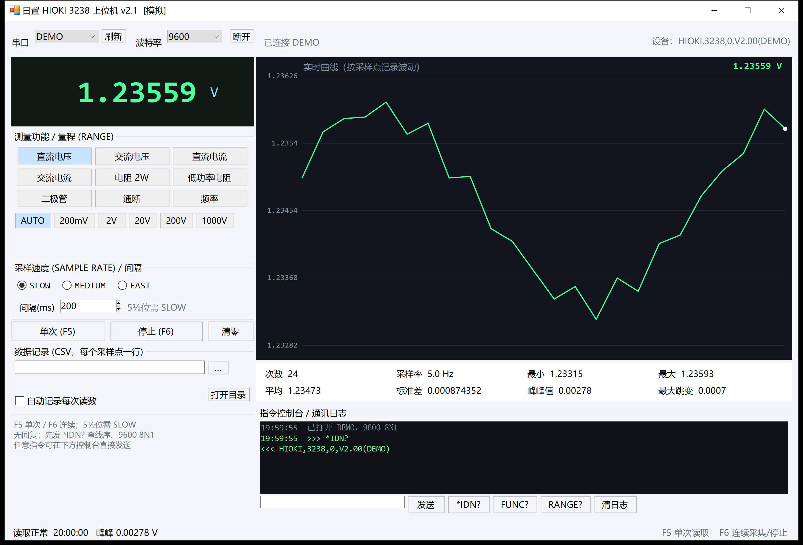

# 日置 HIOKI 3237/3238/3239 上位机（Windows 免安装）

**作者：蓝色大肥鱼**

一个针对 HIOKI 3237 / 3238 / 3239 台式数字万用表 **RS-232C** 接口的 Windows 上位机。
单文件 C# WinForms 实现，编译出来就是一个 **免安装的 exe**，Win7 / Win10 / Win11 都能跑，
不需要 Python、不需要 .NET SDK、不需要管理员权限。



---

## 功能

- **测量功能切换**：直流电压、交流电压、直流电流、交流电流、电阻 2W、低功率电阻、二极管、通断、频率
- **量程切换**：每个功能下自动出现该功能的量程按钮（AUTO + 各档手动量程），数值按手册满量程发送
- **采样速度**：SLOW / MEDIUM / FAST（官方名称），5½ 位用 SLOW
- **5½ 位定长显示**：6 位有效数字不丢尾零（`1.23429`、`199.999`、`0.00123450`）
- **波动记录**：每个采样点写一行 CSV（毫秒时间戳），实时曲线，统计含峰峰值 / 最大跳变 / 标准差 / 实际采样率
- **指令控制台**：任意指令收发并带日志，`*CLS` 一键清仪表错误
- **高 DPI 适配**：1024×768 与 3840×2160@250% 都实测过

## 快速开始

1. 下载 Releases 里的 `Hioki3238-Host-v2.1.exe`（运行后窗口标题为“日置 HIOKI 3238 上位机”），双击运行
2. 接线：9 针**交叉线**（2↔3、3↔2、5↔5），或用 USB 转串口
3. 串口选 COM 口 → 连接 → F5 单次 / F6 连续采集

不需要仪表时可以用模拟模式看界面：

```bat
日置3238上位机.exe --demo
```

## 仪表侧设置（必须一致）

| 项目 | 值 |
|---|---|
| 接口 IF | **rS**（RS-232C） |
| 波特率 / 数据位 / 校验 / 停止位 | 9600 / 8 / None / 1 |
| 分隔符 dELI | **CrLF**（软件发 CR+LF） |
| 指令语言 Lng | **SCP**（日置原厂指令集；选 AdV 会全部报 ERR011） |

## 通讯协议要点（依据 3237/3238/3239 手册第 7 章）

| 用途 | 指令 |
|---|---|
| 读上次测量值（不触发） | `:FETC?` |
| 触发一次并读数 | `:READ?`（要求 `:INIT:CONT 0`） |
| 连续测量 | `:INIT:CONT ON` |
| 切换功能 | `FUNC 'VOLTAGE:DC'` 等 |
| 设量程 | `:VOLT:DC:RANG 1.99999`（发满量程值） |
| 自动量程 | `:VOLT:DC:RANG:AUTO ON`（按功能节点） |
| 采样速度 | `:SAMP:RATE SLOW` |
| 清错误 | `*CLS` |

### 几个坑（都是实测踩出来的）

- `:MEAS?` 不在命令表里 —— 会报 **ERR011（命令错误）**，读数要用 `:FETC?`
- 自动量程没有通用 `:RANG:AUTO`，必须带功能节点（`:VOLT:DC:RANG:AUTO`），否则 ERR011
- 量程值要发**满量程**（2 A 档发 `1.99999`，不是 `2`），否则 **ERR010（执行错误）**
- 功能名要用合法短形式或长形式：`LPR` / `LPRESISTANCE`，写 `LPRES` 会 ERR010
- 错误码：ERR010 执行错误、ERR011 命令错误、ERR200~399 EEPROM 故障

## 目录

```
Main.cs          全部源码（C# WinForms，单文件）
app.manifest     DPI 感知清单
app.ico          程序图标（16~256 七种尺寸）
build.bat        一键重编译（用 Windows 自带 csc.exe）
gen_icon.py      图标生成脚本（Python + Pillow）
界面预览.png      界面截图
```

## 编译

双击 `build.bat`，或手动：

```bat
csc /target:winexe /codepage:65001 /optimize+ /platform:anycpu ^
    /win32manifest:app.manifest /win32icon:app.ico ^
    /r:System.dll /r:System.Windows.Forms.dll /r:System.Drawing.dll ^
    /out:日置3238上位机.exe Main.cs
```

## 许可

MIT License，详见 [LICENSE](LICENSE)。作者：**蓝色大肥鱼**。
